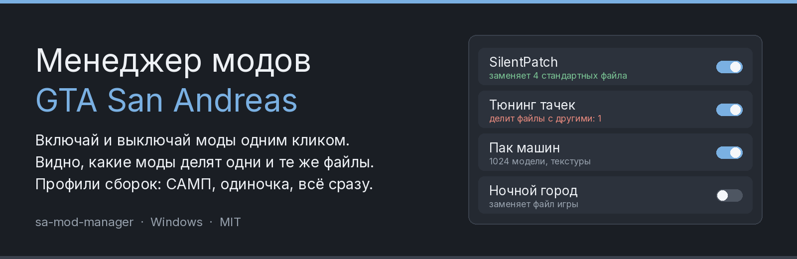
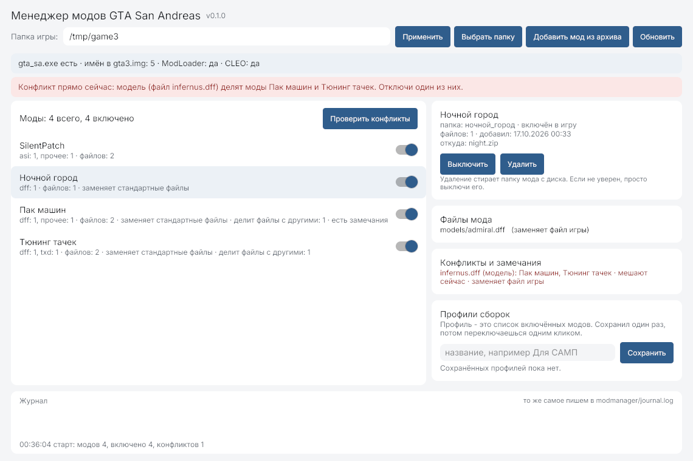

[Русский](README.md) | [English](README.en.md) | [**Español**](README.es.md) | [Português](README.pt.md)





# Gestor de mods para GTA San Andreas

Programa para Windows que mantiene ordenada una instalación con mods: un interruptor por mod, aviso cuando dos mods usan el mismo archivo y perfiles de configuración guardados.

El problema de siempre: instalas cinco mods, el juego no arranca y el culpable es un solo `infernus.dff` que pusieron dos mods a la vez. El gestor muestra esos choques antes de abrir el juego.

**Descargar:** [sa-mod-manager-windows.zip](https://github.com/hilsetapp/sa-mod-manager/releases/latest/download/sa-mod-manager-windows.zip)

## Qué hace

- **Lista de mods con interruptores.** Un mod vive en `modloader` (activado) o en `modmanager/off` (desactivado). Activar solo mueve la carpeta: nada se borra y todo se puede revertir.
- **Búsqueda de conflictos.** Si dos mods traen un archivo con el mismo nombre, el gestor dice quién discute y por qué archivo, separando lo que rompe el juego ahora de lo que solo conviene saber.
- **Marca de archivos originales.** Los archivos que ya están en `models/gta3.img` se marcan como "reemplaza un archivo del juego".
- **Avisos sobre archivos sospechosos.** Reemplazo completo de `gta3.img`, un `d3d9.dll` desconocido, un `.exe` dentro del mod: mejor saberlo antes.
- **Perfiles de configuración.** Guarda el conjunto de mods activados ("SA-MP", "un jugador") y cambia entre ellos con un clic.
- **Diario.** Todo lo que hace el gestor se escribe en la ventana y en `modmanager/journal.log`.
- **Importar desde zip.** Elige el archivo, se descomprime en la carpeta de mods desactivados y lo activas cuando quieras.
- **Funciona con instalaciones manuales.** Los mods que ya pusiste a mano en `modloader` aparecen solos en la lista.

## Cómo empezar

1. Descarga `sa-mod-manager-windows.zip` y descomprímelo en cualquier carpeta, mejor no en `Program Files`.
2. Ejecuta `sa-mods.exe`. Si Windows muestra el aviso azul de SmartScreen, pulsa "Más información" y luego "Ejecutar de todas formas". El programa no descarga nada.
3. Pulsa **"Выбрать папку"** (elegir carpeta) y señala la carpeta donde está `gta_sa.exe`, normalmente `C:\Games\GTA San Andreas`.
4. Pulsa **"Добавить мод из архива"** (añadir mod desde archivo) y elige el zip del mod: aparecerá desactivado.
5. Actívalo con el interruptor y abre el juego.

La interfaz está en ruso: la herramienta está hecha primero para la escena de San Andreas en ruso. Los jugadores de habla hispana son bienvenidos, la traducción de la interfaz está en la lista de tareas.

Ojo: para que el juego vea la carpeta `modloader` hace falta tener **ModLoader** (`modloader.asi`) instalado. Si no está, el gestor lo avisa en la parte de arriba, porque activar mods sin ModLoader no cambia nada en el juego.

## Línea de comandos

`sa-mods-cli.exe` hace lo mismo sin ventana, útil para scripts:

```
sa-mods-cli.exe -game "C:\Games\GTA San Andreas" -check
sa-mods-cli.exe -game "C:\Games\GTA San Andreas" -list
sa-mods-cli.exe -game "C:\Games\GTA San Andreas" -conflicts
sa-mods-cli.exe -game "C:\Games\GTA San Andreas" -import C:\Descargas\silentpatch.zip
```

Opciones: `-check` qué hay en la carpeta del juego, `-list` mods, `-conflicts` choques, `-import` añadir zip, `-enable` y `-disable` activar o desactivar por nombre de carpeta.

## Cómo funciona por dentro

- San Andreas reconoce los archivos por su nombre. Si dos mods traen `infernus.dff`, gana la última carpeta y uno de los mods deja de funcionar en silencio. Por eso un conflicto aquí es "el mismo nombre de archivo en dos mods", y en archivos de datos (`.cfg`, `.dat`, `.ipl`) "la misma ruta relativa".
- Los scripts CLEO (`.cs`), los plugins ASI (`.asi`) y los `.fxt` también se comparan por nombre.
- Activar y desactivar mueve una carpeta entre `modloader` y `modmanager/off`. El gestor no modifica el juego, no escribe en los archivos `.img` ni toca tus archivos.
- Los nombres dentro de `models/gta3.img` se leen solo para saber qué mod reemplaza un archivo original.

## Qué no hace

- No ejecuta instaladores `.exe` ni edita scripts ajenos.
- No compara el contenido de los modelos, solo los nombres de archivo, igual que el juego.
- No descarga mods y no incluye catálogo de enlaces.
- No es una app de navegador ni de móvil: es un programa de escritorio para Windows.

## Compilar

Necesitas Go 1.26 o más nuevo, sin compilador de C:

```
go test ./...
go build -ldflags "-H=windowsgui -s -w" -o sa-mods.exe ./cmd/sa-mods
go build -s -w -o sa-mods-cli.exe ./cmd/sa-mods-cli
```

## Licencia

MIT. La fuente Inter usa la licencia SIL Open Font License 1.1, detalle en [THIRD_PARTY_NOTICES.md](THIRD_PARTY_NOTICES.md).
